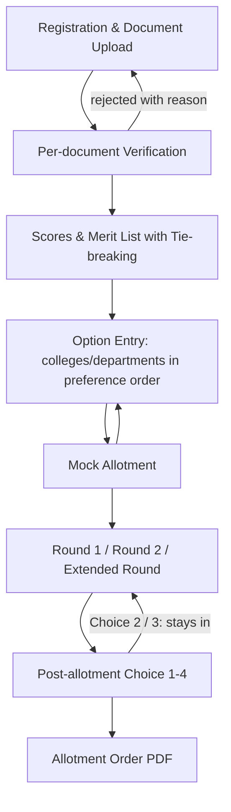

# 🎓 Faculty Counselling System

A centralized, automated merit-based faculty-to-college allocation web application inspired by State CET (Common Entrance Test) counselling systems.

The software evaluates faculty qualifications, experience, degrees (e.g., M.Tech, Ph.D.), research publications, and certifications against admin-defined dynamic scoring rules, generates a merit rank list, and transparently allots faculty members to colleges categorized across different tiers (Tier 1, Tier 2, Tier 3).

---

## 📌 Table of Contents
- [Overview & Workflow](#-overview--workflow)
- [Key Features](#-key-features)
- [Tech Stack](#-tech-stack)
- [Project Architecture](#-project-architecture)
- [Database Configuration](#-database-configuration)
- [Local Setup & Installation](#-local-setup--installation)
- [Seed Data & Demo Accounts](#-seed-data--demo-accounts)
- [Production Hosting & Deployment Guide](#-production-hosting--deployment-guide)
  - [Option A: Fullstack on Render / Railway](#option-a-fullstack-on-render--railway-recommended)
  - [Option B: Decoupled (Vercel Frontend + Render Backend)](#option-b-decoupled-deployment)
  - [Option C: Self-Hosted / VPS (Ubuntu, Nginx, PM2, MySQL)](#option-c-self-hosted-vps-digitalocean--aws-ec2)
- [API Reference](#-api-reference)
- [License](#-license)

---

## 🔄 Overview & Workflow

The platform mimics state counselling boards to eliminate manual bias and ensure 100% merit-based faculty placement:



1. **Registration & Submission**: Faculty register, fill in qualifications, specialization and date of birth, and upload certificates.
2. **Per-document Verification**: Admins approve or reject each certificate. A rejection carries a reason; the faculty member sees it and re-uploads that document. A faculty member is verified once every document is approved.
3. **Scoring & Merit List**: Admin-defined scoring rules produce a total score. Ties are broken by a configurable rule (default: higher degree, then more experience, then more papers, then older date of birth).
4. **Option Entry**: Each verified faculty member lists college/department seats in their own order of preference. Only departments matching their specialization are offered.
5. **Preference-based Allotment**: Going down the merit list, each person gets the highest option on their list that still has a vacancy. A mock round shows likely results without holding seats; then Round 1, Round 2 and an extended round are run.
6. **Post-allotment Choices** (like KCET): Choice 1 accept and join; Choice 2 accept but try for a better option next round; Choice 3 reject but stay for the next round; Choice 4 quit. Seats freed by Choice 3/4 (and by anyone who makes no choice) go back into the pool for the next round.
7. **Allotment Order**: Faculty download a PDF letter with college, department, rank, round and reporting deadline.

Every phase (registration, verification, option entry, results, choices) has admin-set dates. Pages and APIs open and lock automatically; a phase with no dates configured is always open.

**Reservation categories**: the admin defines categories (e.g. Women, PwD) alongside General. Each department's seats are split into quotas. A faculty member competes for General seats on merit first, then for their own category's seats. In the extended round, unfilled reserved seats become General.

**Transparency**: the seat matrix and opening/closing ranks per college, department, category and round are public (`/cutoffs`), applicants can look up their rank with email + date of birth (`/rank-lookup`), and every admin and college action is recorded in an audit log.

---

## ✨ Key Features

### 👨‍💼 Admin Panel
- **Dashboard & Analytics**: Real-time stats on total registrations, verified/pending/rejected applicants, total colleges, and seat allocation rates.
- **College Management**: Create, edit, and delete colleges with codes, locations, tier classification (`Tier 1`, `Tier 2`, `Tier 3`) and vacancies per department (e.g. `Computer Science: 3, Electronics: 2`).
- **Dynamic Scoring Rules**: Build customizable scoring conditions (`eq`, `gte`, `lte`, `gt`, `lt`, `in`, `exists`) without code changes.
- **Verification Portal**: Approve or reject each document with a reason, or review all at once.
- **Merit Rank Generator**: One-click score computation and rank assignment with a configurable tie-breaking order. Ranks lock once Round 1 has run.
- **Counselling Schedule**: Set open/close dates for each phase.
- **Counselling Rounds**: Run the mock allotment, Round 1, Round 2 and the extended round; view results per round and the live seat matrix; undo the latest round or reset all counselling.
- **Bulk Import**: Create or update colleges and department/category seats from a CSV or Excel file, with a dry-run check first.
- **College Logins**: Give each college a login to confirm that allotted faculty reported for duty.
- **Merit List Export**: Download the ranked list as CSV or PDF.
- **Analytics**: Applicant progress, seats filled by tier, department and category, and round-over-round movement.
- **Announcements**: Post notices to faculty, colleges or everyone.
- **Audit Log**: Who verified whom, who ran which round, and every other admin/college action.

### 👩‍🏫 Faculty Panel
- **User Dashboard**: Visual progress bar tracking verification status, score, merit rank, and allotted institution.
- **Profile & Qualification Manager**: Forms for personal details, specialization, experience, and certifications.
- **Document Uploader**: Upload certificates, see each document's review status and rejection reason, and re-upload rejected ones.
- **Option Entry**: Add, remove and reorder college/department options until the deadline.
- **Allotment Status**: Mock result, current allotment, Choice 1-4, round history, and allotment order PDF download.
- **Score Breakdown**: Points earned against each scoring rule.
- **Notifications**: In-portal bell plus email when documents are verified or rejected, results are out, a choice is recorded, a seat lapses, the college confirms joining, and 24 hours before each deadline.
- **Account**: Email verification on registration and forgot-password reset links.

### 🏫 College Panel
- **Allotted Faculty**: Contact details, round and choice of everyone allotted to the college; mark each as reported or not reported.

---

## 🛠 Tech Stack

| Layer | Technology | Purpose |
|---|---|---|
| **Frontend** | React 18, Vite | High-performance Single Page Application |
| **Styling** | Tailwind CSS, Heroicons | Modern, responsive responsive UI |
| **Routing & State** | React Router v6, Context API | Client-side routing and global auth state |
| **Backend** | Node.js, Express.js (ES Modules) | RESTful API server |
| **Database & ORM** | Sequelize v6 with SQLite / MySQL | Flexible database layer supporting both zero-config file DB and production MySQL |
| **Authentication** | JSON Web Tokens (JWT), bcryptjs | Secure role-based authorization |
| **File Storage** | Multer | File uploads for faculty certificates |

---

## 📂 Project Architecture

```
FacultyCounselling/
├── backend/
│   ├── config/
│   │   └── db.js                 # Database connection (SQLite / MySQL)
│   ├── controllers/
│   │   ├── adminController.js    # Colleges & seats, scoring, verification, merit list
│   │   ├── authController.js     # Login, register, me
│   │   ├── counsellingController.js # Rounds, undo/reset, schedule, results
│   │   └── facultyController.js  # Profile, documents, options, choices, PDF
│   ├── middleware/
│   │   ├── auth.js               # JWT verification & role validation
│   │   └── phase.js              # Locks routes outside their schedule phase
│   ├── models/
│   │   ├── Allotment.js          # One allotment per faculty per round + choice status
│   │   ├── College.js            # College registry
│   │   ├── CounsellingRound.js   # Mock / Round 1 / Round 2 / Extended, with undo log
│   │   ├── DepartmentSeat.js     # Vacancies per college department
│   │   ├── OptionEntry.js        # Faculty preference lists
│   │   ├── SchedulePhase.js      # Phase open/close dates
│   │   ├── ScoringCriteria.js    # Dynamic scoring rules schema
│   │   ├── Setting.js            # Tie-break order
│   │   ├── User.js               # Faculty & Admin records
│   │   └── index.js              # Sequelize associations
│   ├── services/
│   │   ├── allotment.js          # Allotment engine, rounds, choices, undo
│   │   ├── allotmentPdf.js       # Allotment order letter (pdfkit)
│   │   ├── documents.js          # Per-document status
│   │   ├── merit.js              # Tie-breaking rules
│   │   └── schedule.js           # Phase open/closed logic
│   ├── routes/
│   │   ├── admin.js              # /api/admin endpoints
│   │   ├── auth.js               # /api/auth endpoints
│   │   └── faculty.js            # /api/faculty endpoints
│   ├── uploads/                  # Uploaded faculty documents
│   ├── .env.example              # Environment variables template
│   ├── seed.js                   # Admin, scoring criteria, demo colleges & faculty
│   └── server.js                 # Express app entrypoint
├── frontend/
│   ├── src/
│   │   ├── api/axios.js          # Axios client with JWT interceptor
│   │   ├── components/           # Navbar, Sidebar, Layout, Modal, StatCard
│   │   ├── context/AuthContext.jsx # Auth provider
│   │   ├── pages/
│   │   │   ├── admin/            # Dashboard, Colleges, Scoring, Verify, Merit, Schedule, Allotment
│   │   │   ├── faculty/          # Dashboard, Profile, Uploads, OptionEntry, AllotmentStatus
│   │   │   ├── Login.jsx
│   │   │   └── Register.jsx
│   │   ├── App.jsx
│   │   └── main.jsx
│   ├── index.html
│   ├── tailwind.config.js
│   └── vite.config.js            # API proxy configured to backend
├── .gitignore
└── README.md
```

---

## 🗄 Database Configuration

The backend supports **both SQLite (default, zero setup) and MySQL**.

### SQLite (Default)
In `backend/.env`:
```env
PORT=5000
DB_DIALECT=sqlite
DB_STORAGE=./database.sqlite
JWT_SECRET=your_jwt_secret_key_here
```

### MySQL
In `backend/.env`:
```env
PORT=5000
DB_DIALECT=mysql
DB_HOST=localhost
DB_USER=root
DB_PASSWORD=your_password
DB_NAME=faculty_counselling
JWT_SECRET=your_jwt_secret_key_here
```
*(Make sure to run `CREATE DATABASE faculty_counselling;` in MySQL before seeding).*

---

## 🚀 Local Setup & Installation

### Prerequisites
- Node.js (v18.x or later)
- npm (v9.x or later)
- Git

### 1. Clone the repository
```bash
git clone https://github.com/SanjayrajN-in/FacultyCounselling.git
cd FacultyCounselling
```

### 2. Set up the Backend
```bash
cd backend
npm install

# Copy environment file
cp .env.example .env

# Seed initial admin account and default scoring rules
node seed.js

# Start backend server
npm run dev
# (Server runs at http://localhost:5000)
```

### 3. Set up the Frontend
In a new terminal window:
```bash
cd frontend
npm install

# Start Vite development server
npm run dev
# (App opens at http://localhost:5173)
```

---

## 🔑 Seed Data & Demo Accounts

When you run `node seed.js`, the database creates:

### 1. Default Admin Credentials
- **Email:** `admin@faculty.com`
- **Password:** `admin123`
- **Role:** Administrator

### 2. Pre-configured Scoring Rules
| Criterion | Condition | Points Awarded |
|---|---|---|
| **M.Tech Degree** | `highestDegree IN ['M.Tech', 'PhD']` | **+3 points** |
| **PhD Degree** | `highestDegree == 'PhD'` | **+5 points** |
| **5+ Years Experience** | `yearsOfExperience >= 5` | **+2 points** |
| **10+ Years Experience** | `yearsOfExperience >= 10` | **+4 points** |
| **NET / SET Qualified** | `netSetQualified == true` | **+3 points** |
| **5+ Research Papers** | `researchPapers >= 5` | **+2 points** |

### 3. Demo Colleges & Faculty
Three colleges with department seats (Computer Science, Electronics, Mechanical) and seven verified faculty with option lists already entered, so you can generate the merit list and run rounds straight away.
- **Emails:** `faculty1@faculty.com` … `faculty7@faculty.com`
- **Password:** `faculty123`

A college login for GEC01: `college1@faculty.com` / `college123`. Categories Women and Persons with Disability are set up, with a Women quota seat in GEC01 Computer Science.

Two of them have identical qualifications, to show the tie-breaking rule in action.

---

## ✉️ Email Setup

Notifications, email verification and password reset use SMTP. Set `APP_URL` and the `SMTP_*` variables in `backend/.env` (see `.env.example`). Without `SMTP_HOST`, emails are printed to the backend console instead, which is handy in development: copy the verification or reset link from there.

---

## 🌐 Production Hosting & Deployment Guide

### Option A: Fullstack on Render / Railway (Recommended)

#### 1. Backend on Render (Web Service)
1. Link your GitHub repository (`FacultyCounselling`).
2. Set **Root Directory** to `backend`.
3. Set **Build Command:** `npm install`
4. Set **Start Command:** `node server.js`
5. Configure Environment Variables in Render Dashboard:
   - `PORT`: `5000` (or leave default for Render to supply)
   - `JWT_SECRET`: `[Generate a random 64-char string]`
   - `DB_DIALECT`: `sqlite` (or configure Render PostgreSQL / MySQL addon)
   - `DB_STORAGE`: `/data/database.sqlite` (attach a Persistent Disk if using SQLite)

#### 2. Frontend on Render (Static Site) or Vercel
1. Link the repository.
2. Set **Root Directory** to `frontend`.
3. Set **Build Command:** `npm run build`
4. Set **Publish Directory:** `dist`
5. In `frontend/src/api/axios.js`, set `baseURL` to your backend URL (e.g. `https://your-backend.onrender.com/api`).

---

### Option B: Decoupled Deployment

- **Frontend:** Deploy to **Vercel** / **Netlify** / **Cloudflare Pages** by selecting the `frontend` folder.
- **Backend:** Deploy to **Railway.app** or **Render.com** with a MySQL database plugin.
  - Set `DB_DIALECT=mysql`
  - Fill `DB_HOST`, `DB_USER`, `DB_PASSWORD`, `DB_NAME` from your Railway/Render MySQL service.

---

### Option C: Self-Hosted / VPS (DigitalOcean / AWS EC2 / Ubuntu)

#### 1. Server Preparation
```bash
sudo apt update && sudo apt upgrade -y
sudo apt install -y nodejs npm nginx mysql-server git
sudo npm install -g pm2
```

#### 2. Clone & Build
```bash
cd /var/www
git clone https://github.com/SanjayrajN-in/FacultyCounselling.git
cd FacultyCounselling

# Backend
cd backend
npm install --production
cp .env.example .env
# Edit .env with production DB credentials
nano .env
node seed.js
pm2 start server.js --name "faculty-backend"

# Frontend
cd ../frontend
npm install
npm run build
```

#### 3. Nginx Reverse Proxy Configuration
```nginx
server {
    listen 80;
    server_name your-domain.com;

    # Serve React SPA Frontend
    location / {
        root /var/www/FacultyCounselling/frontend/dist;
        try_files $uri $uri/ /index.html;
    }

    # Proxy API requests to Node backend
    location /api {
        proxy_pass http://localhost:5000;
        proxy_http_version 1.1;
        proxy_set_header Upgrade $http_upgrade;
        proxy_set_header Connection 'upgrade';
        proxy_set_header Host $host;
        proxy_cache_bypass $http_upgrade;
    }

    # Proxy uploaded static documents
    location /uploads {
        proxy_pass http://localhost:5000;
    }
}
```

---

## 📡 API Reference

### Authentication (`/api/auth`)
- `POST /api/auth/register` — Register a faculty applicant *(registration phase)*.
- `POST /api/auth/login` — Sign in and receive JWT token.
- `GET /api/auth/me` — Retrieve active authenticated profile.
- `POST /api/auth/verify-email` — Confirm email with the emailed token.
- `POST /api/auth/resend-verification` — Send a new verification link.
- `POST /api/auth/forgot-password` / `POST /api/auth/reset-password` — Password reset by emailed link (valid one hour).

### Public (`/api/public`) *(no login)*
- `GET /api/public/seat-matrix` — Seats and vacancies per college, department and category.
- `GET /api/public/cutoffs` — Opening/closing ranks per college, department, category and published round.
- `POST /api/public/rank-lookup` — Rank by `{ email, dateOfBirth }`.
- `GET /api/public/categories` — Reservation categories.

### Account (`/api/account`) *(any signed-in user)*
- `GET /api/account/notifications`, `POST /api/account/notifications/read` — In-portal notifications.
- `GET /api/account/announcements` — Announcements for your role.

### College (`/api/college`) *(college logins)*
- `GET /api/college/overview` — Your college, seats and allotted faculty.
- `PUT /api/college/allotments/:id/reporting` — Mark `reported` / `not_reported` (with a note).

### Admin Operations (`/api/admin`) *(Bearer Token Required, Admin only)*
- `GET /api/admin/dashboard-stats` — Overview metrics.
- `GET / POST /api/admin/colleges` — List / Add colleges. Body takes `seats: [{ department, totalSeats }]`.
- `PUT / DELETE /api/admin/colleges/:id` — Update / Delete college (seats cannot drop below those already allotted).
- `GET /api/admin/departments` — Department names in use.
- `GET /api/admin/seat-matrix` — Filled and total seats per college department.
- `GET / POST /api/admin/scoring-criteria` — List / Add evaluation criteria.
- `PUT / DELETE /api/admin/scoring-criteria/:id` — Update / Delete scoring rule.
- `GET /api/admin/faculty-list` — Filter candidates by verification status.
- `PUT /api/admin/faculty/:id/documents/:docId` — Approve or reject one document (`{ status: 'approved' | 'rejected', reason }`).
- `PUT /api/admin/verify-faculty/:id` — Approve all documents, or reject all unapproved ones with a reason.
- `POST /api/admin/calculate-scores` — Calculate merit points for verified faculty.
- `POST /api/admin/generate-merit-list` — Assign ranks (score, then tie-breakers). Locked once Round 1 has run.
- `GET /api/admin/merit-list` — Verified faculty in rank order.
- `GET / PUT /api/admin/tie-breakers` — Read / set the tie-break order (`degree`, `experience`, `papers`, `dob`).
- `GET / PUT /api/admin/schedule` — Read / set phase dates (`registration`, `verification`, `option_entry`, `results`, `choices`).
- `GET /api/admin/rounds` — Rounds run so far and which round is next.
- `POST /api/admin/rounds` — Run a round (`{ type: 'mock' | 'round1' | 'round2' | 'extended', reportingDeadline }`). `POST /api/admin/run-allotment` runs the next pending round.
- `POST /api/admin/rounds/:id/undo` — Undo the most recent round.
- `POST /api/admin/counselling/reset` — Delete all rounds and allotments.
- `GET /api/admin/allotment-results?roundId=` — Allotments for a round (defaults to the latest).
- `GET / PUT /api/admin/categories` — Reservation categories.
- `POST /api/admin/colleges/import[?dryRun=true]` — Bulk import from CSV/XLSX; `GET /api/admin/colleges/import-template` for the format.
- `POST /api/admin/colleges/:id/accounts`, `GET /api/admin/college-accounts`, `DELETE /api/admin/college-accounts/:userId` — College logins.
- `GET /api/admin/merit-list/export?format=csv|pdf` — Merit list export.
- `GET /api/admin/analytics` — Seat fill and round movement.
- `GET /api/admin/audit-log` — Audit trail (`action`, `actor`, `limit`, `offset` filters).
- `GET / POST /api/admin/announcements`, `PUT / DELETE /api/admin/announcements/:id` — Announcements.

### Faculty Operations (`/api/faculty`) *(Bearer Token Required, Faculty only)*
- `GET /api/faculty/schedule` — Phase dates and whether each is open.
- `GET / PUT /api/faculty/profile` — View / update profile *(registration phase; qualifications lock once verified)*.
- `POST /api/faculty/upload-documents` — Upload a certificate (`file`, `documentName`) *(registration phase)*.
- `PUT /api/faculty/documents/:docId` — Re-upload a rejected document *(registration or verification phase)*.
- `GET /api/faculty/my-score` — View granular score breakdown & points earned.
- `GET /api/faculty/options/available` — Seats matching your specialization.
- `GET / PUT /api/faculty/options` — View / replace your ordered option list (`{ seatIds: [...] }`) *(option entry phase)*.
- `GET /api/faculty/allotment-status` — Mock result, current allotment, history and allowed choices *(from the results phase start)*.
- `POST /api/faculty/allotment/choice` — Exercise a choice (`accept`, `upgrade`, `reject`, `quit`) *(choices phase)*.
- `GET /api/faculty/allotment/order.pdf` — Download the allotment order.

Document upload, re-upload and option entry also require a verified email.

---

## 📄 License
This project is open-source and available under the [MIT License](LICENSE).# Facuilty-counselling
